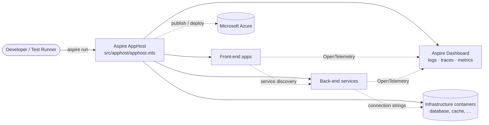

# Use Aspire to Orchestrate Naked Time for Local Development and Testing

## Context and Problem Statement

Naked Time will be built from several cooperating components: front-end
applications, back-end services, and the infrastructure they depend on, such
as databases and caches. Each developer needs to start all of these
components on their own computer, wire them together with the right
connection strings, ports, and secrets, and see what is happening across all
of them while they debug. Automated tests need that same environment. And
the topology that runs on a laptop should match the topology deployed to
Azure as closely as possible.

How should Naked Time describe, start, connect, and observe its components
during local development and automated testing, so that the setup stays
consistent, repeatable, and close to production?

## Decision Drivers

* **One-command startup.** A new contributor should be able to clone the
  repository, run the setup script once, and then start the whole product
  with a single command (`./run.sh` or `Run-Time.ps1`).
* **Cross-platform support.** The workflow must work the same way on macOS,
  Linux, and Windows.
* **Service discovery and configuration.** Components should get each
  other's endpoints and connection strings automatically, without
  hand-maintained `.env` files or hard-coded ports.
* **Observability during development.** Logs, traces, and metrics from every
  component should be visible in one place while debugging.
* **Testability.** Integration and end-to-end tests should be able to start
  the same application topology programmatically.
* **Path to Azure.** The application model used locally should also be
  usable to provision and deploy Naked Time to Azure.
* **Defined in code.** The topology should be written as typed code in a
  language the project already uses (TypeScript), so it can be linted,
  reviewed, and refactored like the rest of the code.

## Considered Options

* Aspire (TypeScript AppHost)
* Docker Compose
* Hand-written scripts and documentation
* Kubernetes-based local development (e.g., Tilt, Skaffold, or minikube)

## Decision Outcome

Chosen option: "Aspire (TypeScript AppHost)". It is the only option that
meets every decision driver with one tool: code-first orchestration, built-in
service discovery, a development dashboard with OpenTelemetry, support for
integration testing, and a deployment path to Azure from the same
application model.

The AppHost lives in `src/apphost/apphost.mts` and is configured by
`src/apphost/aspire.config.json`. Developers start it with `aspire run`,
which `run.sh` and `Run-Time.ps1` wrap.

### Consequences

* Good, because developers start the whole product with one command on any
  supported operating system.
* Good, because endpoints, connection strings, and secrets flow from the
  application model to each component, so per-developer configuration drift
  goes away.
* Good, because the Aspire dashboard collects logs, distributed traces, and
  metrics from every component during development without extra setup.
* Good, because tests can start the same topology the developers use, so
  integration and end-to-end tests run against a realistic environment.
* Good, because the same application model can drive provisioning and
  deployment to Azure, which keeps local and cloud topologies aligned.
* Good, because the AppHost is TypeScript, so it is linted, type-checked,
  and reviewed like the rest of the codebase.
* Good, because the Aspire CLI installs agent skills for Claude Code and
  GitHub Copilot, so AI assistants have accurate guidance for working with
  the AppHost.
* Bad, because every contributor must install the Aspire CLI, and a
  container runtime once infrastructure resources are added.
* Bad, because the TypeScript AppHost is newer than the C# AppHost, so it may
  lag in features, integrations, and community examples.
* Bad, because the project depends on Aspire's release cadence and has to
  keep up with breaking changes in the SDK and CLI.
* Neutral, because developers need to learn Aspire's concepts (resources,
  references, endpoints, and the dashboard), though the concepts are small.

### Confirmation

* `./run.sh` and `Run-Time.ps1` start Naked Time only through `aspire run`.
  No other orchestration scripts or Compose files are added to the
  repository.
* Every new runtime component and infrastructure dependency is registered as
  a resource in `src/apphost/apphost.mts` and gets its configuration through
  Aspire references, not hard-coded values.
* Code review checks that new services emit OpenTelemetry data that shows up
  in the Aspire dashboard.
* Integration and end-to-end tests start the application through the
  AppHost.

## Pros and Cons of the Options

### Aspire (TypeScript AppHost)

[Aspire](https://aspire.dev) is a code-first toolchain for building,
running, observing, and deploying distributed applications. An AppHost
program declares the application's resources and how they relate, and the
Aspire CLI runs that model locally or publishes it for deployment.

* Good, because orchestration, service discovery, configuration, and
  observability come from one tool.
* Good, because it includes a development dashboard with OpenTelemetry
  support.
* Good, because the same model supports local runs, testing, and Azure
  deployment.
* Good, because the AppHost is written in TypeScript, which the project
  already uses.
* Neutral, because it runs containers when needed but doesn't require
  everything to be containerized.
* Bad, because it adds the Aspire CLI as a prerequisite and a dependency on
  Aspire's release cadence.
* Bad, because TypeScript AppHost support is less mature than the C#
  AppHost.

### Docker Compose

A YAML file that declares containers, networks, and volumes, started with
`docker compose up`.

* Good, because it is widely known and well documented.
* Good, because it works the same on every platform that has Docker.
* Bad, because every component has to run in a container, which slows the
  inner loop and makes attaching debuggers harder.
* Bad, because service discovery is limited to container DNS names, and
  connection strings and secrets have to be maintained by hand.
* Bad, because it has no built-in dashboard for logs, traces, and metrics.
* Bad, because YAML has no type checking, and Compose files don't translate
  directly into an Azure deployment.

### Hand-written scripts and documentation

Shell and PowerShell scripts plus README instructions that start each
component separately.

* Good, because it has no extra tool dependencies.
* Bad, because the scripts have to be kept in sync for bash and PowerShell.
* Bad, because ports, connection strings, and startup order are managed by
  hand and break easily.
* Bad, because there is no shared observability, and every developer ends up
  with a slightly different setup.
* Bad, because tests and deployment can't reuse the setup.

### Kubernetes-based local development (Tilt, Skaffold, or minikube)

Run a local Kubernetes cluster and deploy the application into it with
manifests or Helm charts.

* Good, because local and production environments match closely if
  production also runs on Kubernetes.
* Bad, because a local cluster is heavyweight and has a steep learning
  curve.
* Bad, because the inner loop is slow (image builds and deploys on each
  change).
* Bad, because it is more than a small team needs during early development,
  and Naked Time has not chosen Kubernetes as its production platform.

## More Information

* [Aspire documentation](https://aspire.dev)
* [Install the Aspire CLI](https://aspire.dev/get-started/install-cli/)
* The initial AppHost skeleton was added in commit `964f68d`
  ("chore: create the Aspire AppHost").
* Revisit this decision if Naked Time's production hosting moves away from
  Azure, or if the TypeScript AppHost proves too limited for the components
  Naked Time needs.
