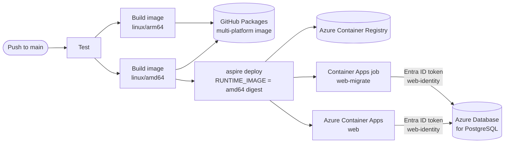

# Deploy the Web Application to Azure Container Apps with Aspire and GitHub Actions

## Context and Problem Statement

The Naked Time web application (`src/web`) is a Phoenix application backed
by PostgreSQL. [ADR 0001](0001-use-aspire-for-development-and-testing.md)
chose Aspire to orchestrate the product locally, with a path to Azure. The
web application now needs to be packaged and deployed to Azure in a way
that is repeatable, fast to build, and secure.

How should the web application be built, packaged, deployed, and connected
to its database in Azure?

## Decision Drivers

* **Aspire-native deployment.** The AppHost should stay the source of truth
  for the Azure topology (`aspire deploy`), not separately maintained
  infrastructure code.
* **Fast CI builds.** Dependencies should not be downloaded and compiled
  again when they haven't changed.
* **No database passwords.** The application should authenticate to the
  database without a stored password.
* **Developer access to images.** Developers on Apple silicon and x64
  computers should be able to run the published image.
* **Safe migrations.** Database migrations should run once per deployment,
  not once per replica.

## Considered Options

For building the container image:

* GitHub Actions builds the image with BuildKit layer caching; Aspire
  deploys it.
* `aspire deploy` builds the image from the Dockerfile.
* GitHub Actions builds the release with `mix`, and a single-stage
  Dockerfile copies it.

For database authentication:

* Microsoft Entra ID tokens with a user-assigned managed identity.
* Password authentication with the credentials stored in Azure Key Vault.

For migrations:

* An Azure Container Apps job.
* Run the migrations when the container starts.

## Decision Outcome

* **Hosting:** Azure Container Apps, using an Azure Container Apps
  environment in the AppHost (`addAzureContainerAppEnvironment`). Aspire
  provisions the environment, Azure Container Registry, Log Analytics, the
  Aspire dashboard, Azure Database for PostgreSQL, and the managed identity.
* **Packaging:** an Elixir release in a multi-stage Dockerfile
  (`src/web/Dockerfile`).
* **Image build:** GitHub Actions builds the image with
  `docker/build-push-action` and the GitHub Actions cache backend
  (`type=gha,mode=max`), on native amd64 and arm64 runners. It publishes a
  multi-platform image to GitHub Packages. The Dockerfile's final stage is
  chosen by the `RUNTIME_IMAGE` build argument. During deployment, the
  AppHost sets it to the amd64 image that CI built (`WEB_RUNTIME_IMAGE`), so
  the build that `aspire deploy` runs only re-tags that image and pushes it
  to Azure Container Registry.
* **Database authentication:** Microsoft Entra ID. The web application and
  the migration job share the user-assigned managed identity `web-identity`,
  which Aspire makes a Microsoft Entra administrator of the PostgreSQL
  server. `NakedTime.AzurePostgresToken` gets an access token from the
  Azure Container Apps managed identity endpoint for each new database
  connection, using the Postgrex `:configure` callback.
* **Migrations:** a manually triggered Azure Container Apps job
  (`web-migrate`) that runs `/app/bin/migrate` from the same image. The
  GitHub Actions workflow starts it after `aspire deploy` completes.

### Consequences

* Good, because the dependency layers are reused from the GitHub Actions
  cache until `mix.lock` or the compile-time configuration changes.
* Good, because the image that is tested and published is the same image
  that is deployed.
* Good, because the AppHost still owns the whole Azure topology, including
  registry access through managed identity.
* Good, because no database password exists to leak or rotate.
* Good, because developers can pull a native image for their architecture
  from GitHub Packages.
* Good, because `aspire deploy` from a developer's computer still works: when
  `WEB_RUNTIME_IMAGE` is not set, the release is built from source.
* Bad, because the token provider is custom code, and the application only
  supports managed identity authentication through Azure Container Apps'
  identity endpoint.
* Bad, because the migration job runs after the new application revision is
  deployed. Migrations must be compatible with the previous version of the
  application (expand and contract).
* Bad, because the Aspire CLI installs the AppHost dependencies with
  `pnpm install --ignore-workspace`. That ignores `allowBuilds` in
  `pnpm-workspace.yaml`, so the workflow approves the esbuild build script
  again through the `pnpm_config_allow_builds` environment variable, as
  `run.sh` and `Run-Time.ps1` already do.

### Confirmation

* The `Web` workflow (`.github/workflows/web.yml`) is the only path that
  deploys to production.
* `aspire publish` produces Bicep with the `web` container app, the
  `web-migrate` job, the `web-identity` identity, and PostgreSQL
  administrator assignments for that identity.

## Pros and Cons of the Options

### GitHub Actions builds the image; Aspire deploys it

* Good, because BuildKit's GitHub Actions cache backend caches every stage.
* Good, because the same build publishes the developer images.
* Neutral, because it relies on the `RUNTIME_IMAGE` build argument to avoid
  building twice.

### `aspire deploy` builds the image

* Good, because it is the simplest workflow (one command).
* Bad, because Aspire runs `docker buildx build` without cache import or
  export options, so every deployment compiles the dependencies again.

### Build the release with `mix` on the runner

* Good, because `actions/cache` can cache `deps` and `_build` directly.
* Bad, because the release depends on the runner's operating system and
  libraries, and local or arm64 builds need a different path.

### Password authentication through Azure Key Vault

* Good, because Postgrex supports it without custom code.
* Bad, because a long-lived password has to be stored and rotated.

### Run migrations when the container starts

* Good, because it needs no extra resources or workflow steps.
* Bad, because every replica runs the migrations when it starts.

## More Information

* [Deploy to Azure Container Apps](https://aspire.dev/deployment/azure/)
* [Docker cache storage backends: GitHub Actions](https://docs.docker.com/build/cache/backends/gha/)
* [Microsoft Entra authentication with Azure Database for PostgreSQL](https://learn.microsoft.com/azure/postgresql/flexible-server/concepts-azure-ad-authentication)
* [Managed identities in Azure Container Apps](https://learn.microsoft.com/azure/container-apps/managed-identity)
* See [Deploying Naked Time](../deployment.md) for the one-time setup.
